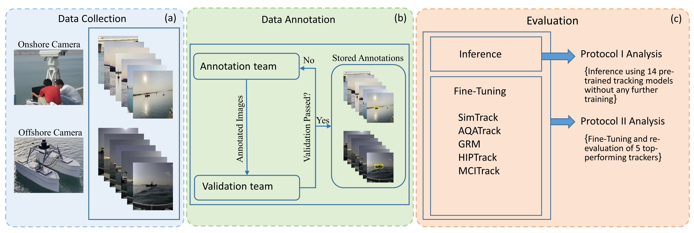

# HIPTrack on MVTD

Maritime single object tracking on the [MVTD](https://github.com/AhsanBaidar/MVTD) benchmark, with
[HIPTrack](https://github.com/WenRuiCai/HIPTrack) as the baseline. We changed the loss and the augmentation
to better handle small targets, look-alike vessels and sea clutter.



*Figure from the [MVTD](https://github.com/AhsanBaidar/MVTD) repository.*

This repository started as a 2025 Fall mini project.

## Dataset and baseline

- **MVTD** ([paper](https://arxiv.org/abs/2506.02866), [data](https://huggingface.co/datasets/AhsanBB/Maritime_Visual_Tracking_Dataset_MVTD)):
  182 videos (about 150K frames) of four classes (Boat, Ship, SailBoat, USV) in GOT-10k format.
  159 sequences are used for training and 23 for testing.
- **HIPTrack** (CVPR 2024): a ViT-B tracker with candidate elimination and a historical prompt network.
  The backbone is initialized from DropTrack and stays frozen during training.
  We start from the HIPTrack code in the MVTD repository.

## What we changed and why

| What we saw | What we changed |
|---|---|
| Test targets are much smaller than training targets (median √(wh) of 67 px vs. 130 px, and 45% vs. 16% of frames below 64 px). After cropping, every target takes up about the same share of the search region, so small targets are harder mainly because of their low resolution. | Scale-aware loss. The GIoU and L1 terms of each sample are weighted by the target size in the original image, `w = clip((64/s)^γ, 1, 3)`, and the weights are normalized to a batch mean of 1. |
| Similar vessels, waves, glare and wakes make the tracker drift. The focal loss on the heatmap does not directly push target and background features apart. | Target contrast loss. An InfoNCE loss pulls target tokens toward the target prototype and pushes background tokens away. It is applied to the feature that goes into the head, because the backbone is frozen. Tokens on the box border are left out. |
| Lighting changes a lot (glare, haze, dusk). | Random contrast and gamma augmentation. |

The options are in the `TRAIN` section of `HIPTrack/experiments/hiptrack/hiptrack_got.yaml`:
`SCALE_AWARE_LOSS`, `SCALE_REF_PX`, `SCALE_GAMMA`, `SCALE_W_MAX`, `SCALE_NORMALIZE`, `CONTRAST_WEIGHT` (0 turns it off) and `CONTRAST_TAU`.

## Environment

- Ubuntu, CUDA 11.3, Python 3.8
- PyTorch 1.10 to 1.13 (2.x does not work), numpy below 1.24

```bash
pip install torch==1.10.1+cu113 torchvision==0.11.2+cu113 -f https://download.pytorch.org/whl/cu113/torch_stable.html
pip install "numpy<1.24" timm==0.5.4 thop easydict pyyaml opencv-python pandas jpeg4py \
            pycocotools lmdb tensorboard wandb visdom matplotlib tqdm
sudo apt install libturbojpeg   # needed by jpeg4py
```

## Usage

**1. Data and weights**
```
<repo>/
├── dataset/MVTD2/{train,test}/      # MVTD, each split with list.txt and <seq>/ folders
└── HIPTrack/pretrained_models/DropTrack_k700_800E_alldata.pth.tar
```
The DropTrack weights are linked in the Training section of the [HIPTrack README](https://github.com/WenRuiCai/HIPTrack).

**2. Paths**

On the first run, the code writes `lib/train/admin/local.py` and `lib/test/evaluation/local.py` with the default paths above and exits.
Edit them if your data lives somewhere else, then run again.

**3. Train**

Run from `HIPTrack/`. Checkpoints, logs and tensorboard files are saved under `HIPTrack/ckpt/`.
```bash
GPUS=0,1,2,3 bash run_train_multi.sh     # multiple GPUs
GPUS=0 bash run_train_single.sh          # single GPU
```
The scripts do not set any NCCL variables. Add them if your machine needs them, for example `NCCL_P2P_DISABLE=1 GPUS=0,1 bash run_train_multi.sh`.

**4. Test and evaluate**

Set `TEST.EPOCH` in the yaml to pick a checkpoint from `ckpt/checkpoints/train/hiptrack/hiptrack_got/`.
```bash
python tracking/test.py hiptrack hiptrack_got --dataset_name got10k_test --threads 8 --num_gpus 1
python tracking/analysis_results.py      # set parameter_name='hiptrack_got/got10k' in the script first
```

## Acknowledgement and license

This code builds on [HIPTrack](https://github.com/WenRuiCai/HIPTrack) and the [MVTD](https://github.com/AhsanBaidar/MVTD) code base,
which in turn build on [OSTrack](https://github.com/botaoye/OSTrack) and [PyTracking](https://github.com/visionml/pytracking).
It is released under the [Apache-2.0](LICENSE) license. Third-party code keeps its original license.
